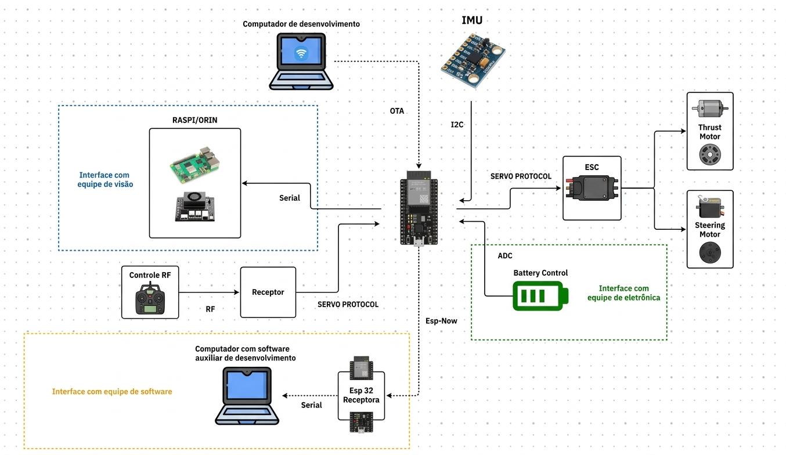

# Robocar — Firmware

Documentação do firmware do carro: o que é **específico** da competição.

## Visão geral

- **Competição:** Robocar
- **Edição atual:** 2026
- **Responsável pelo firmware:** João Victor
- **Repositório do código:** [robocar-firmware](https://github.com/Liga-Academica-de-Sistemas-Embarcados/robocar-firmware.git)
- **Notion de Firmware:** [notion-embarcados](https://app.notion.com/p/Embarcados-347f3329488480718286dfdbbbc4550d?v=210f3329488480afb731000c0dee58b8&source=copy_link)

## Arquitetura do sistema

## Páginas

| Página | Conteúdo |
|--------|----------|
| [Pinagem](pinagem.md) | Mapa de pinos do carro |

