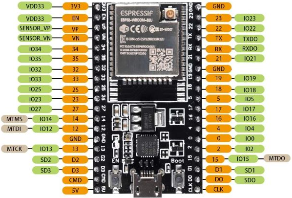

# Pinagem

**Placa / MCU:** ESP32-WROOM32U

| Pino | Função | Periférico | Conectado a | Observação |
|------|--------|------------|-------------|------------|
|      |        |            |             |            |

!!! warning "Mantenha sincronizado"
    Qualquer mudança de pino no código deve ser refletida aqui e no esquemático.
